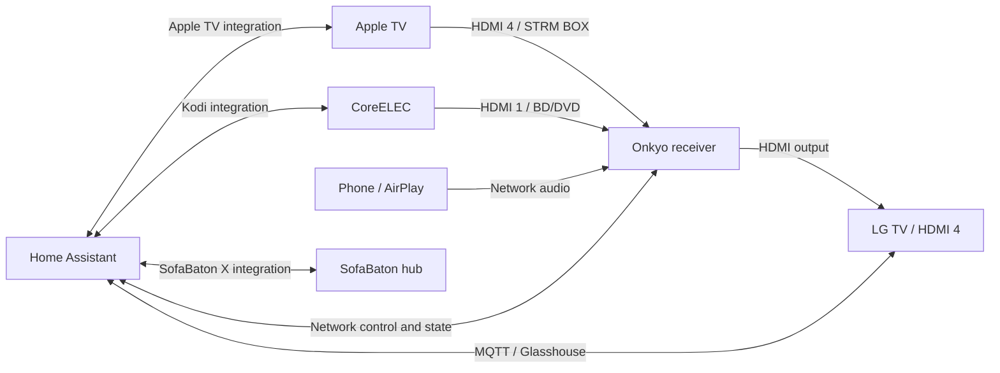

# LG OLED + SofaBaton + Onkyo Automation

Home Assistant examples for making an LG OLED TV, an Onkyo receiver, an Apple TV, and a SofaBaton remote behave like one system—even when you switch between remotes.

The main feature is **Music mode**: play Apple Music on Apple TV through the receiver, including Dolby Atmos when the source and equipment support it, while the OLED screen stays black. A single switch in Home Assistant or Apple Home restores the picture when you want it back.

The rest of the configuration handles the awkward parts around that feature: synchronizing SofaBaton after an Apple TV remote wake, shutting everything down, protecting receiver-only AirPlay, and stopping delayed actions from undoing newer commands.

This is a reference configuration extracted from a working room. It contains YAML examples and regression tests; it is not a HACS integration or an installer. Read the setup section and adapt the device names and inputs before enabling it.

## What you get

| Feature | What it does |
| --- | --- |
| One Music mode switch | Blanks the panel without powering off the TV or interrupting the HDMI audio path. Turning the switch off restores the picture. |
| Apple TV remote coordination | Explicitly wakes the TV for an Apple TV session and finishes TV shutdown after Apple TV and receiver sleep. |
| SofaBaton synchronization | Starts the matching hub activity after an Apple TV session is confirmed, so the hub can catch up when you used another remote. |
| Shutdown guards | Rechecks current device state so an old shutdown does not interrupt a newer session. |
| CoreELEC cleanup | Sleeps the secondary player only when the receiver is no longer using its input. |
| Optional baby-cry notification | Restores a blanked panel and shows a message from an existing camera detection sensor. |
| Optional audio mode selection | Chooses a supported Onkyo listening mode from the reported audio format. It does not change power, volume, or HDMI input. |
| Optional AV status view | Shows the TV signal, receiver input format, decoder, and player states using standard dashboard cards. |

## The system this was built for

The original room uses an **LG C1 OLED77C1PUB**, an **Onkyo TX-RZ30**, a **SofaBaton X1S**, Apple TV, and a CoreELEC player. The tested software baseline is Home Assistant **2026.10.4** and the SofaBaton X integration **0.7.1**. Other TVs and receivers may work after adaptation; they have not been verified by this project.



The port numbers refer to this wiring: **receiver HDMI 4** and **TV HDMI 4** are separate settings. An `STRM BOX` source name alone does not identify which physical TV input is in use.

### Music mode versus AirPlay

There are two different listening paths:

- **Apple Music on Apple TV:** audio travels over HDMI through the receiver. Music mode keeps the TV logically powered on and blanks only its panel. It does not launch Music, choose a song, set the volume, or manufacture an Atmos signal.
- **AirPlay directly to the receiver:** the receiver uses its `NETWORK` input and the TV can stay fully off. Music mode is unnecessary for this path. The coordination guards avoid treating that receiver-only session as a TV session.

The Music switch reflects actual state: TV on + panel off means Music mode on. It is not a separate remembered flag. Any other action that restores the panel also makes the switch turn off.

## Why the ordering matters

Two failures motivated most of this configuration:

1. In the original room, waking the TV with LG Auto Power Sync enabled could put an already-on receiver into standby. No Home Assistant receiver-off command appeared during the clean reproduction. This setup leaves SIMPLINK enabled, disables LG Auto Power Sync, and uses a guarded Wake-on-LAN command for TV wake instead. The exact sender on the HDMI bus was not established.
2. When the Apple TV remote started a session, SofaBaton caught up later by replaying the activity's startup macro. That macro included TV power-on, which restored a screen that Music mode had already blanked. Music mode now completes pending hub synchronization **before** blanking. Background synchronization also requires the panel to be on.

Selecting a SofaBaton activity is a real command: it can replay the activity macro. It is not a silent update of the hub's bookkeeping. This project does not rewrite your hub macros or make the hub learn every external source change instantly.

Music On and Off share one restartable script. If On is waiting for hub synchronization and you request Off, the newer request cancels the pending blanking. The optional cry alert uses that same cancellation path before showing its message.

## Before installing

You need working device integrations first:

- A rooted LG TV with [Glasshouse](https://github.com/rorygallagher2024/glasshouse) installed. Follow its own compatibility and installation instructions; this repository does not root the TV.
- An MQTT broker, Home Assistant's MQTT integration, and the [Glasshouse MQTT bridge](https://rorygallagher2024.github.io/glasshouse/HOME-ASSISTANT/) configured. Confirm power, panel, active-app, and power-off entities work.
- The [Apple TV](https://www.home-assistant.io/integrations/apple_tv/) and [Onkyo](https://www.home-assistant.io/integrations/onkyo/) integrations. Onkyo Network Standby must be enabled for network control in standby.
- The [SofaBaton X integration](https://github.com/m3tac0de/home-assistant-sofabaton-x1s), with working activity control and state reporting.
- The [Kodi integration](https://www.home-assistant.io/integrations/kodi/) if keeping the CoreELEC logic.
- Home Assistant able to reach these devices and send a Wake-on-LAN packet to the TV's network. Keep Home Assistant running for this coordination to work.

The reference TV settings are **SIMPLINK on**, **Auto Power Sync off**, and network wake enabled. The receiver retains HDMI-CEC so the Apple TV remote can wake the receiver. Its tested standby-through setting was Auto (Eco), with ARC off because the players connect directly to the receiver. These are observations from this wiring, not universal HDMI/eARC settings. If your sound comes back from the TV over ARC/eARC, adapt that arrangement separately.

Once LG Auto Power Sync is off, waking the TV with the Apple TV remote depends on Home Assistant. SofaBaton still uses its own activity power commands. This configuration does not disable OLED protection features or change panel-care schedules.

## Installation

### 1. Map the example entities and labels

In Home Assistant, open **Developer tools → States** and find your entities. Replace the example IDs throughout the YAML with yours, including IDs inside Jinja templates. If you edit the reference IDs and rerun the tests, update their fixtures too.

| Example entity | Required meaning |
| --- | --- |
| `binary_sensor.lg_tv_power` | Real TV power reported by Glasshouse; separate from panel state. |
| `switch.lg_tv_display_panel` | Glasshouse panel control: off blanks the screen, on restores it. |
| `button.lg_tv_power_off` | Glasshouse TV power-off command. |
| `sensor.lg_tv_active_app` | Its `app_id` attribute identifies the current TV input/app. |
| `media_player.apple_tv` | Apple TV media-player entity with working awake/off state. |
| `media_player.onkyo` | Receiver entity exposing power and the `source` attribute. |
| `select.x1s_hub_activity` | SofaBaton activity selector. |
| `remote.x1s_hub_remote` | SofaBaton remote accepting `remote.turn_on` with an activity. |
| `media_player.coreelec` | Kodi/CoreELEC media-player entity with accurate standby state. |

Also adapt these **literal values**; entity renaming does not change them:

| Reference value | Meaning |
| --- | --- |
| `STRM BOX` | Receiver input for Apple TV. Match the actual `source` attribute exactly. |
| `BD/DVD` | Substring used to recognize the CoreELEC receiver input. |
| `NETWORK` | Receiver-only AirPlay/network audio input. |
| `com.webos.app.hdmi4` | TV input connected to the receiver's HDMI output. |
| `Watch AppleTV`, `Watch Dolby Vision` | Apple TV and CoreELEC SofaBaton activities. |
| `Play Switch`, `Remote HDMI`, `Powered Off` | Other known activities and the hub's off value. Adapt the known-activity lists to your hub. |

**No CoreELEC?** Remove `ugoos_suspend_off_dolby_vision`, and adapt the CoreELEC conditions in `sofabaton_tv_off_backstop` and `lg_tv_sleep_with_apple_tv`. Do not leave a nonexistent player in those checks: `unknown` intentionally does not count as off.

The CoreELEC example uses `System.Shutdown` because that command puts the tested box into its intended standby state and `cansuspend` was false. Confirm your box's behavior and wake method before keeping it; a different device may fully shut down.

### 2. Copy the two core packages

Back up your configuration. Copy these files into Home Assistant's `/config/packages/` directory:

```text
packages/av_coordination.yaml
packages/music_mode.yaml
```

Enable [Home Assistant packages](https://www.home-assistant.io/docs/configuration/packages/) in `configuration.yaml`. Merge with an existing `homeassistant:` section rather than creating a duplicate:

```yaml
homeassistant:
  packages: !include_dir_named packages

wake_on_lan:
```

The [`wake_on_lan:` entry](https://www.home-assistant.io/integrations/wake_on_lan/) enables the magic-packet action. Keep an existing entry if you already have one.

Merge the keys from [`secrets.yaml.example`](secrets.yaml.example) into `/config/secrets.yaml` and replace both placeholder values. `lg_tv_mac` is your TV's network-interface MAC; `lan_broadcast` is the broadcast address appropriate to your TV's network. Do not copy the example documentation address as a working LAN address.

Review existing automations that control the same equipment. Disable superseded copies before enabling these packages; running both old and new shutdown routines defeats the coordination.

### 3. Validate and verify the created entities

Run Home Assistant's configuration check, then restart Home Assistant to load the packages. Check the logs for loading errors as well: a valid YAML/configuration check alone does not prove every script loaded.

Confirm these exact entity IDs exist, with no `_2` suffix:

```text
switch.music_mode
script.lg_tv_music_mode
automation.lg_tv_wake_for_apple_tv
automation.sofabaton_auto_start_watch_appletv_on_cec_session
```

The examples deliberately give the script and the two referenced automations names that produce these IDs on a fresh install. If an existing entity registry entry chooses a different ID, rename it through Home Assistant's entity settings or update **every** corresponding reference. Automation YAML `id` values are not the same thing as entity IDs.

### 4. Try Music mode and optionally expose it to Apple Home

Start Apple Music on Apple TV at your normal volume and confirm audio reaches the receiver. Turn `switch.music_mode` on: the screen should blank and audio should continue. Turn it off: the picture should return. If the hub had not synchronized yet, initial activation may take several seconds; the sync wait times out after 20 seconds instead of blanking blindly.

For Apple Home, add **only `switch.music_mode`** to your existing [HomeKit Bridge](https://www.home-assistant.io/integrations/homekit/) inclusion filter, or create a bridge if you do not already have one. There are no separate Music On and Music Off accessories. Keep an existing bridge and entity identity when updating this setup so you do not need to rebuild Home app automations.

## Optional examples

Files in `optional/` are not loaded automatically. Install only the ones you want.

- **[`baby_cry_alert.yaml`](optional/baby_cry_alert.yaml):** copy to `/config/packages/`, replace `binary_sensor.baby_cry_detected` with an existing camera sensor, and choose the notification text. The original sensor came from a G6 Instant camera. A real off-to-on detection restores the panel, shows a toast, and leaves playback running. The TV must already be on. Repeated detections are suppressed for one minute. The alert leaves the picture on; it does not automatically return to Music mode. This is a convenience notification, not the camera's detection implementation or a substitute for a baby monitor.
- **[`onkyo_audio_auto.yaml`](optional/onkyo_audio_auto.yaml):** copy to `/config/packages/`. Enable `input_boolean.onkyo_audio_auto` to opt in; leave it off for manual listening-mode selection. The helper interprets receiver metadata, waits 12 seconds for it to settle, and selects a mode only if the receiver advertises support. Turning the helper off cancels pending Auto work. Adapt HDMI port checks and mode labels to your receiver. It cannot add Atmos to content that does not contain it.
- **[`av_status_view.yaml`](optional/av_status_view.yaml):** add as a view in a dashboard's raw configuration, **not** as a package. Adapt the entities for picture mode, video signal, and dynamic range. It uses standard Markdown cards and hides stale signal details when the corresponding device is off. To show these cards only on a CoreELEC screen, place the cards inside your existing conditional dashboard layout. The reference view itself is a manually opened subview.

## What the core automations do

| YAML ID | Responsibility |
| --- | --- |
| `lg_tv_wake_for_apple_tv` | Wake the TV only after an Apple TV/receiver start or a known input change confirms an Apple TV session. Restored input metadata alone cannot wake it. |
| `lg_tv_sleep_with_apple_tv` | Finish TV shutdown when Apple TV sleeps and the receiver is off, including before hub synchronization. Exclude other activities and native TV apps. |
| `sofabaton_auto_start_appletv_on_cec` | After 30 seconds of a confirmed Apple TV session with the panel on, start the matching SofaBaton activity. Music mode can request the same guarded sync earlier. |
| `sofabaton_lg_tv_off_sync` | After a real TV on-to-off transition held for 15 seconds, end the hub activity unless a newer explicit wake or receiver-only network session prevents cleanup. |
| `sofabaton_tv_off_backstop` | Turn the TV off immediately when a known hub activity ends, then check for an unwanted re-wake only after both players sleep and current state still permits shutdown. |
| `atv_sleep_on_hub_power_off` | Sleep a leftover Apple TV after hub shutdown only if the TV and receiver are still off and Apple TV has not started a newer session. |
| `atv_wake_on_appletv_activity` | Wake Apple TV for a real transition into its SofaBaton activity; ignore unknown/unavailable hub reconnections. |
| `ugoos_suspend_off_dolby_vision` | Put an unused CoreELEC box into standby while protecting the receiver's actual CoreELEC input and avoiding playback interruption on reconnection. |

Unknown or unavailable device state is treated cautiously. It can block cleanup; it is not proof that the device is off. These automations coordinate observed state rather than periodically forcing every device into the hub's last activity.

## Testing and known limits

The original room passed live tests for CoreELEC → Apple TV switching, hub activity shutdown, Apple TV sleep before hub synchronization, Music Off cancelling a pending On, and continued Atmos playback with the panel blank beyond the background-sync delay. Receiver volume was unchanged. Physical remote behavior still needs checking in each installation.

The repository also includes **28 isolated interaction tests** using Home Assistant's native script, condition, wait, and cancellation machinery. They exercise ordering around shutdown, wake, Music mode, alerts, reconnects, and optional audio Auto. State and service calls are fake; no live configuration, credentials, broker, or device is contacted. Delays are shortened, triggers are supplied by the tests, and the full automation scheduler and HDMI bus are not simulated. Real AirPlay playback and an actual cry event were not repeated in the final live audit.

To run the reference tests on a compatible Linux environment with Python 3.14:

```sh
python -m venv .venv
. .venv/bin/activate
python -m pip install -r requirements-test.txt
python tests/test_configuration.py
python tests/test_interactions.py
```

GitHub Actions runs the same tests against the pinned Home Assistant version. Passing them verifies the reference examples, not a reader's wiring, physical remote macros, or integration state reporting. If you change entities, activities, or inputs, adapt the fixtures and repeat the live checks below.

### Check your installation

1. Start a session with SofaBaton, switch sources, and shut it down.
2. Start Apple TV with its own remote. Confirm the receiver and TV wake and the hub eventually catches up. Shut down once after sync and once before the 30-second sync delay.
3. Toggle Music On → Off while synchronization is pending. The picture should stay on after the newer Off request. Then enable Music mode and wait beyond the background-sync delay.
4. Try receiver-only AirPlay with the TV off. Confirm old TV/player cleanup does not stop it.
5. If installed, test the notification through Home Assistant's automation test action while the TV is on. This sends a real toast; it does not prove the camera recognizes a cry.

### Troubleshooting

| Symptom | Check |
| --- | --- |
| Panel comes back during Music mode | Look for a delayed SofaBaton startup macro or another TV power-on automation. Confirm the guarded sync entity reference is correct and the startup macro has finished. |
| Music switch or helper is unavailable/missing | Check MQTT panel state, entity IDs, and script loading errors. Verify the helper action exists in Developer tools → Actions. |
| Apple TV remote wakes the receiver but not the TV | Check HA availability, TV WOL settings, broadcast reachability, source labels, TV input ID, and the wake automation trace. |
| Shutdown does nothing | Look for an unknown player/receiver state, wrong input string, or a different activity. The guards deliberately stop when they cannot confirm shutdown is appropriate. |
| SofaBaton activity cannot be controlled | Check its integration connection and whether the official SofaBaton app currently owns the hub connection. |
| Atmos is missing | Inspect the receiver's reported incoming signal, source app/content, and HDMI path. A listening-mode label or TV badge alone does not establish what reached the speakers. |

To roll back, disable these packages' automations, remove the installed examples, and restore your previous configuration and LG power-sync setting. Do not enable both the old and replacement coordination routines together.

## Credits and license

Built on [Home Assistant](https://www.home-assistant.io/), [Glasshouse](https://github.com/rorygallagher2024/glasshouse), and [SofaBaton X for Home Assistant](https://github.com/m3tac0de/home-assistant-sofabaton-x1s). Those projects provide the integrations and device control; this repository supplies room coordination examples. It does not include a root exploit, native-app audio patches, or changes to Dolby codec support.

MIT licensed. Independent community examples; not affiliated with LG, SofaBaton, Onkyo, or Apple.
